# Déconvolution de signaux : des méthodes lineaires, variationnelles aux réseaux déroulés

 

Projet personnel réalisé dans le cadre de mon Master Signal, Image et Apprentissage Automatique. L'objectif est de comparer, sur un problème simple et bien contrôlé, plusieurs familles de méthodes pour les **problèmes inverses** : retrouver un signal $x$ à partir d'une observation floutée et bruitée.

Le projet ne propose pas de méthode nouvelle. Il réimplémente des approches connues, de la régularisation classique aux méthodes hybrides « modèle + apprentissage », et essaie de les comparer honnêtement, y compris là où elles échouent.

## Sommaire

1. [Le problème](#1-le-problème)
2. [Méthodes implémentées](#2-méthodes-implémentées)
3. [Protocole expérimental](#3-protocole-expérimental)
4. [Résultats](#4-résultats)
5. [Ce que je retiens](#5-ce-que-je-retiens)
6. [Limites](#6-limites)
7. [Pistes d'amélioration](#7-pistes-damélioration)
8. [Utilisation](#8-utilisation)
9. [Références](#9-références)

## 1. Le problème

On observe :

$$y = Hx + n, \qquad n \sim \mathcal{N}(0, \sigma^2 I)$$

où $H$ est la convolution par une réponse impulsionnelle $h$ (un flou gaussien) et $n$ un bruit blanc dont le niveau est fixé par le BSNR (*Blurred SNR*).

**Hypothèse périodique.** Avec des conditions aux bords périodiques, $H$ est circulante et diagonalisée par la FFT : ses valeurs singulières sont les $|H(f)|$, et toutes les opérations coûtent $O(N \log N)$. En contrepartie, le modèle décrit mal ce qui se passe aux bords d'un signal réel.

**Pourquoi le problème est mal posé.** Pour un flou gaussien, $|H(f)|$ décroît très vite avec la fréquence. L'inversion directe $Y(f)/H(f)$ divise le bruit par des nombres minuscules. Au-delà d'une certaine fréquence, $|Y(f)|$ n'est plus que du bruit et l'information sur $x$ est perdue : il faut ajouter une connaissance a priori, c'est le rôle de la **régularisation**.

Les signaux de test comportent des **sauts** (que le flou détruit) et des **parties lisses**. Des extraits audio servent de test hors distribution.

## 2. Méthodes implémentées

| Famille | Méthode | Idée | Fichier |
|---|---|---|---|
| Référence | Inversion naïve | $\hat X = Y/H$ | `naive_inverse.m` |
| Linéaire | Wiener (oracle) | atténue chaque fréquence selon le rapport bruit/signal | `wiener_deconv.m` |
| Linéaire | Tikhonov | $\min \|y-Hx\|^2 + \lambda\|Rx\|^2$, avec $R = I$ ou $D$ | `tikhonov_deconv.m` |
| Linéaire | Choix de $\lambda$ | GCV, courbe en L, principe de Morozov | `select_lambda.m` |
| Variationnelle | TV par ADMM | $\min \tfrac12\|y-Hx\|^2 + \lambda\|Dx\|_1$, découpage $z = Dx$ | `admm_tv.m` |
| Variationnelle | TV par Chambolle-Pock | même critère, algorithme primal-dual | `chambolle_pock_tv.m` |
| Variationnelle | Ondelettes par FISTA | parcimonie des coefficients de Haar | `fista_wavelet.m` |
| Hybride | Plug-and-Play ADMM | l'étape a priori d'ADMM est remplacée par un débruiteur | `pnp_admm.m` |
| Hybride | Chambolle-Pock déroulé | 15 itérations = 15 couches aux paramètres appris | `unrolled_cp_forward.m` |
| Apprise | CNN boîte noire | CNN 1D résiduel (type DnCNN) qui apprend $y \mapsto x$ | `build_cnn1d.m` |
| Extension | Déconvolution aveugle | estimation alternée de $x$ et de $h$ | `blind_deconv_am.m` |

**Tikhonov arrondit les sauts, la TV les préserve.** Pour monter de 0 à 1, comparons un saut unique et une rampe de dix marches de 0,1 :

| Pénalité | Saut unique | Dix marches de 0,1 |
|---|---|---|
| $\|Dx\|_2^2$ (Tikhonov) | 1 | 0,1 |
| $\|Dx\|_1$ (TV) | 1 | 1 |
| $\|Dx\|_0$ | 1 | 10 |

Tikhonov préfère étaler un saut, la TV est indifférente (ce sont les données qui décident), et $\ell_0$ préfère activement le saut.

**ADMM sépare la physique et l'a priori.** L'étape sur $x$ contient le flou et les mesures (résolue par FFT), l'étape sur $z$ ne contient que l'a priori (un seuillage doux). Le Plug-and-Play remplace cette seconde étape par un débruiteur, ici un CNN entraîné uniquement à débruiter.

**Le réseau déroulé garde le modèle physique.** Le Chambolle-Pock déroulé utilise deux variables duales (données et TV), ce qui évite toute inversion de matrice. Chaque couche apprend ses pas $\tau_k$, $\sigma_k$, son seuil $\lambda_k$ et un filtre $D_k$ à 3 coefficients : 90 paramètres au total, appris sous forme de logarithme pour rester positifs. L'initialisation reproduit l'algorithme classique. $H$ n'est pas appris.

**Déconvolution aveugle.** On alterne une estimation de $x$ (a priori $\ell_0$ sur le gradient, méthode de Xu et al.) et une estimation de $h$ (gradient projeté sur $\{h \ge 0,\ \sum h = 1\}$), avec une continuation sur $\lambda$ sur 30 itérations, puis une reconstruction finale par ADMM-TV.

## 3. Protocole expérimental

Configuration : $N = 256$, flou gaussien $\sigma_h = 3$ tronqué à 31 points, BSNR de 30 dB.

- les hyperparamètres ($\lambda$, $\rho$) sont réglés sur un **jeu de validation**, jamais sur le jeu de test ;
- un **oracle** (meilleur $\lambda$ connaissant le vrai signal) sert de référence pour mesurer le coût d'un choix automatique ;
- les critères de choix de $\lambda$ sont comparés **de façon appariée** (différences signal par signal, intervalle de confiance à 95 %) ;
- les réseaux sont entraînés sur 4 000 signaux, validés sur 200, testés sur 200 ;
- dans l'étude de robustesse, rien n'est réajusté ni ré-entraîné.

| Script | Question posée |
|---|---|
| `exp01_ill_posedness` | Pourquoi l'inversion directe échoue-t-elle ? |
| `exp02_linear_methods` | Quelle régularisation linéaire, et quel critère pour choisir $\lambda$ ? |
| `exp03_tv_methods` | Que gagne-t-on avec la TV, et quel algorithme converge le plus vite ? |
| `exp04_pnp` | Peut-on remplacer l'a priori TV par un débruiteur appris ? |
| `exp05_learned_methods` | Méthodes apprises contre méthodes variationnelles |
| `exp06_robustness` | Que se passe-t-il si le bruit ou le noyau changent ? |
| `exp07_blind_deconvolution` | Peut-on estimer un noyau inconnu ? |

## 4. Résultats

Les SNR sont des moyennes sur les jeux de test (50 à 200 signaux selon l'expérience).

### 4.1 Le problème est mal posé (exp. 1)

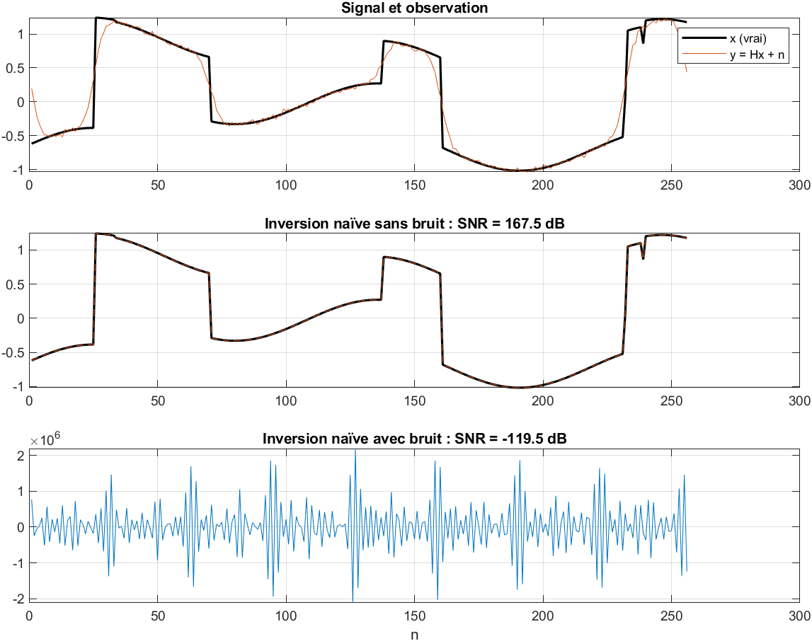

L'inversion naïve reconstruit le signal presque parfaitement sans bruit (167,5 dB), mais tombe à **−119,5 dB** avec un bruit de 30 dB. Il faudrait un BSNR bien au-delà de 100 dB pour obtenir un SNR positif. Le diagramme de Picard montre que $|Y(f)|$ atteint le niveau du bruit vers l'indice 60 à 70 sur 256 : au-delà, les fréquences sont perdues.

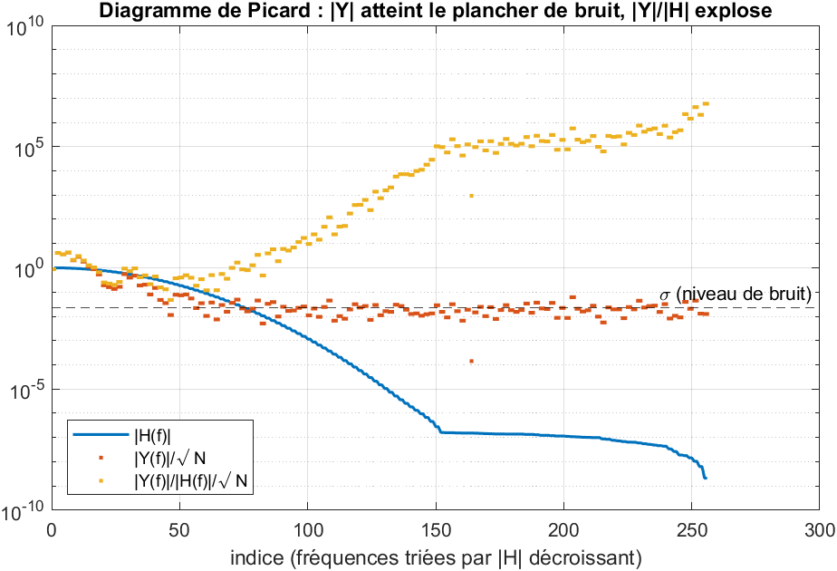

Une observation inattendue : le conditionnement de $H$ est plus faible pour $\sigma_h = 5$ ($4{,}9 \times 10^4$) que pour $\sigma_h = 3$ ($4{,}7 \times 10^8$). C'est un effet de la **troncature du noyau** à 31 points (±5σ pour $\sigma_h = 3$, seulement ±3σ pour $\sigma_h = 5$) : les lobes secondaires empêchent $|H(f)|$ de descendre très bas. Le conditionnement mesure ici la troncature autant que le flou.

### 4.2 Méthodes linéaires et choix de λ (exp. 2)

| Méthode (Tikhonov, $R = D$) | SNR moyen (dB) | Perte par rapport à l'oracle (dB) |
|---|---|---|
| Wiener oracle | 16,80 | — |
| $\lambda$ oracle | 16,71 | — |
| GCV | 16,56 | 0,15 (médiane 0,05) |
| Courbe en L | 16,54 | 0,17 (médiane 0,13) |
| Morozov | 16,07 | 0,64 (médiane 0,63) |

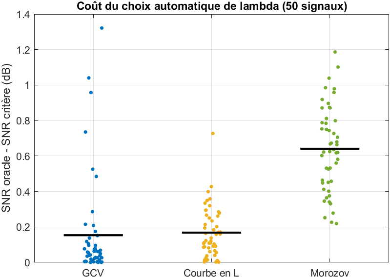

- **GCV et la courbe en L sont équivalents** : la différence moyenne (0,015 dB) n'est pas significative (IC 95 % : [−0,08 ; 0,11]). GCV est meilleur sur la plupart des signaux mais présente quelques échecs isolés (jusqu'à 1,3 dB de perte) ; la courbe en L est plus régulière.
- **Morozov est significativement moins bon**, d'environ 0,5 dB, alors qu'il dispose du vrai σ : la courbe en L le bat sur 100 % des signaux. Il sur-régularise.
- **Wiener oracle ne gagne que 0,09 dB** sur Tikhonov-D oracle : supposer un spectre en $1/f^2$ est presque aussi bon que connaître le vrai spectre.
- $R = I$ et $R = D$ atteignent un SNR oracle très proche (15,2 contre 15,3 dB sur un signal), mais $R = D$ est beaucoup **plus tolérant à un $\lambda$ trop grand**.

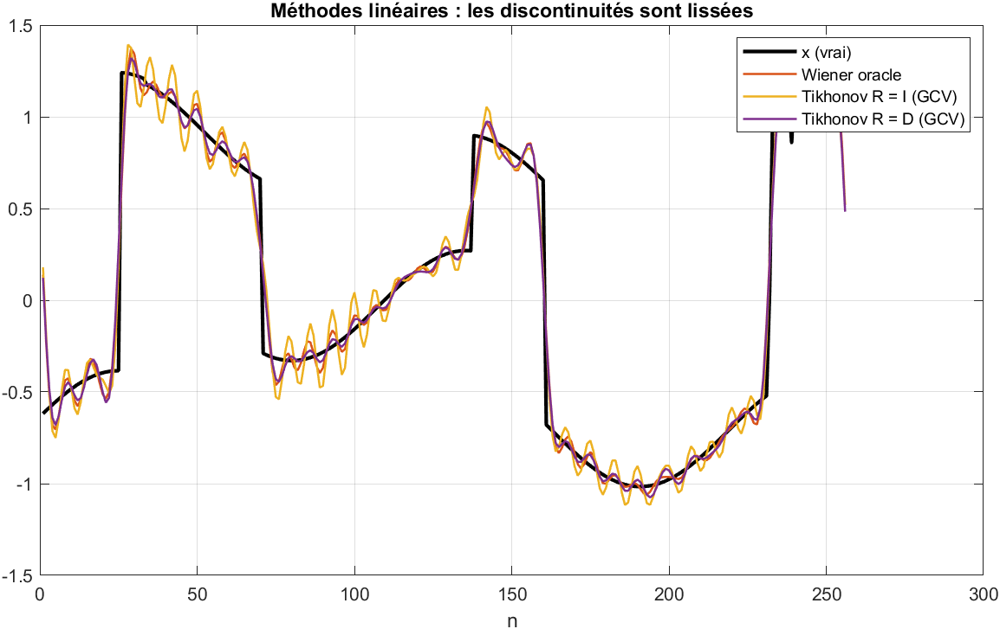

Toutes les méthodes linéaires arrondissent les sauts et produisent des oscillations (phénomène de Gibbs), surtout avec $R = I$.

### 4.3 Variation totale et algorithmes (exp. 3)

| Méthode | SNR moyen (dB) | Écart-type | Temps par signal |
|---|---|---|---|
| Tikhonov-D | 16,27 | 2,53 | 0,11 ms |
| ADMM-TV | 20,44 | 4,17 | 12,9 ms |
| Chambolle-Pock TV | 20,46 | 4,26 | 11,0 ms |
| FISTA Haar | 15,69 | 2,66 | 14,0 ms |

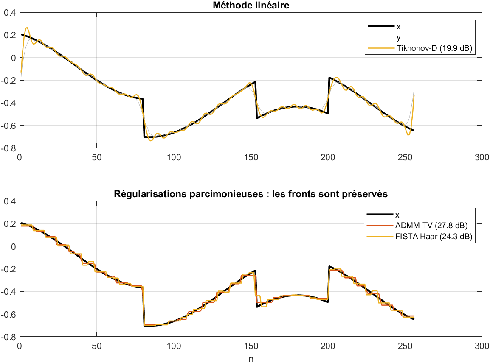

- La TV gagne **environ 4 dB** sur Tikhonov, pour un temps de calcul environ 100 fois plus élevé. Son écart-type plus grand indique que le gain dépend beaucoup du signal (nombre de sauts, part de parties lisses).
- ADMM et Chambolle-Pock donnent le même résultat, comme attendu.
- Sur les parties lisses, la TV crée un **effet escalier** visible.
- FISTA-Haar fait un peu moins bien que Tikhonov. La transformée de Haar décimée n'est pas invariante par translation : un saut coûte plus ou moins cher selon sa position.

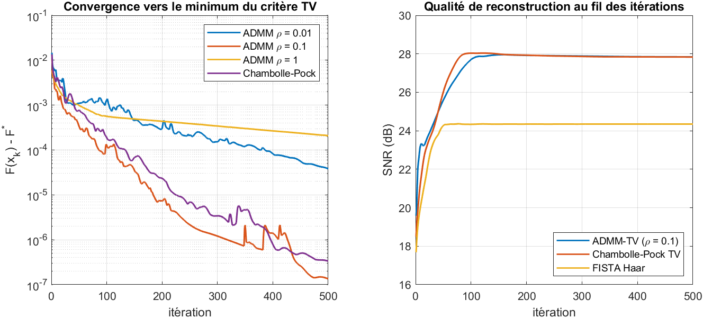

ADMM avec $\rho = 0{,}1$ converge le plus vite ; $\rho = 1$ est nettement plus lent. Le SNR se stabilise après une centaine d'itérations, bien avant la convergence exacte du critère.

### 4.4 Plug-and-Play (exp. 4)

| Méthode | SNR moyen (dB) | Écart-type |
|---|---|---|
| ADMM-TV | 24,52 | 6,74 |
| PnP-ADMM, débruiteur TV | 25,12 | 6,23 |
| PnP-ADMM, débruiteur CNN | 10,51 | 10,51 |

- PnP avec le débruiteur TV donne un résultat proche d'ADMM-TV, ce qui valide l'implémentation. Le petit écart vient du nombre fini d'itérations et du découpage différent : à 100 itérations, ADMM-TV n'a pas encore convergé.
- **PnP avec le débruiteur CNN ne fonctionne pas** dans la version actuelle. Le SNR diverge au fil des itérations, des oscillations de grande amplitude apparaissent **aux bords du signal**, et la sensibilité à $\rho$ ne montre aucun optimum clair.

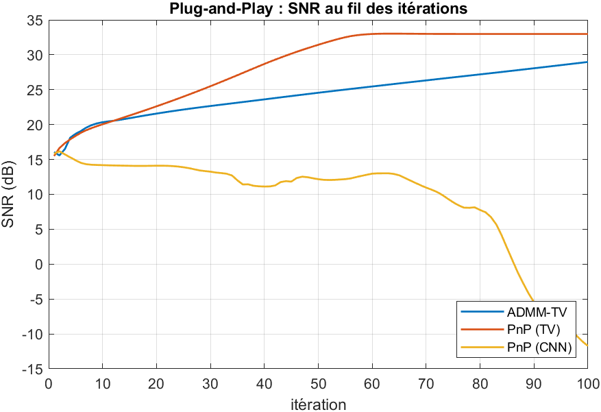

Causes probables : le CNN complète le signal par des zéros aux bords (`'Padding', 'same'`) alors que le reste du modèle est périodique, l'erreur aux bords s'amplifiant à chaque itération ; et un CNN quelconque n'est pas un opérateur proximal, donc la convergence n'est pas garantie. Je n'ai pas encore corrigé ce point.

### 4.5 Méthodes apprises (exp. 5)

| Méthode | SNR test (dB) | SNR audio (dB) | Temps par signal | Paramètres appris |
|---|---|---|---|---|
| Tikhonov-D | 16,66 | **6,17** | 0,02 ms | 1 |
| ADMM-TV | 22,41 | 3,76 | 9,1 ms | 1 |
| PnP-ADMM (CNN) | 9,21 | −8,67 | 25,8 ms | 52 514 |
| **CP déroulé** | **24,34** | 5,00 | 0,56 ms | **90** |
| CNN boîte noire | 21,72 | 4,86 | 2,2 ms | 52 513 |

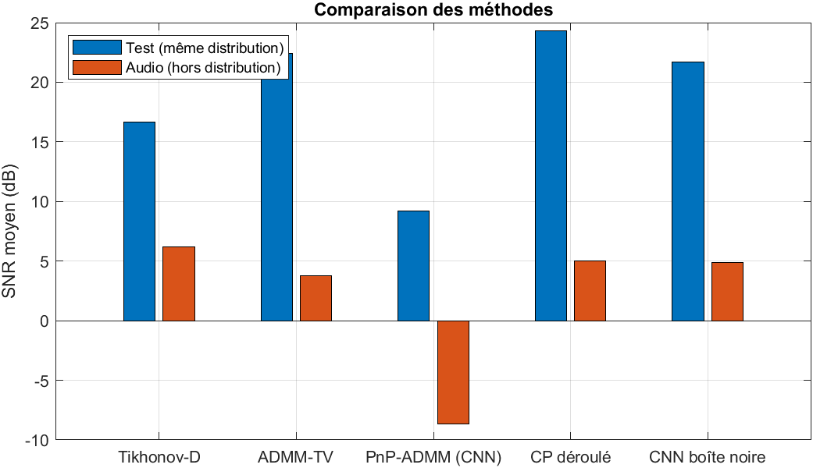

- **Le Chambolle-Pock déroulé obtient le meilleur SNR** sur le jeu de test (+1,9 dB sur ADMM-TV, +2,6 dB sur le CNN boîte noire), avec 90 paramètres contre environ 52 500, et en 15 itérations au lieu de 300 (16 fois plus rapide qu'ADMM-TV).
- **Sur l'audio, toutes les méthodes sont mauvaises**, et c'est **Tikhonov**, l'a priori le moins spécifique, qui fait le mieux. Les a priori conçus ou appris pour des signaux à sauts ne conviennent pas à de l'audio. Le réseau déroulé et le CNN boîte noire généralisent de façon similaire (5,0 et 4,9 dB) : l'avantage attendu des méthodes à modèle hors distribution n'apparaît pas ici.

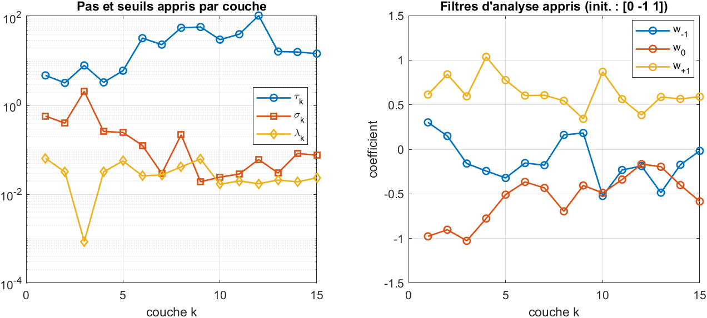

Le réseau déroulé est interprétable :
- les pas $\tau_k$ augmentent fortement au fil des couches (de 3–5 jusqu'à près de 100), tandis que les pas $\sigma_k$ diminuent. Pour plusieurs couches, $\tau_k \sigma_k \|K\|^2$ dépasse 1 : le réseau ne respecte plus la condition de convergence de l'algorithme d'origine. Il se comporte comme un estimateur à profondeur fixe, plus comme un algorithme convergent ;
- les seuils $\lambda_k$ restent de l'ordre de 0,02 à 0,06, avec une exception à la couche 3 ;
- les filtres s'éloignent du gradient $[0, -1, 1]$ : le coefficient central diminue en valeur absolue au fil des couches, mais les filtres restent proches de filtres de différence (somme proche de 0).

L'apprentissage converge en une vingtaine d'époques (SNR de validation d'environ 24,3 dB) sans surapprentissage visible.

### 4.6 Robustesse (exp. 6)

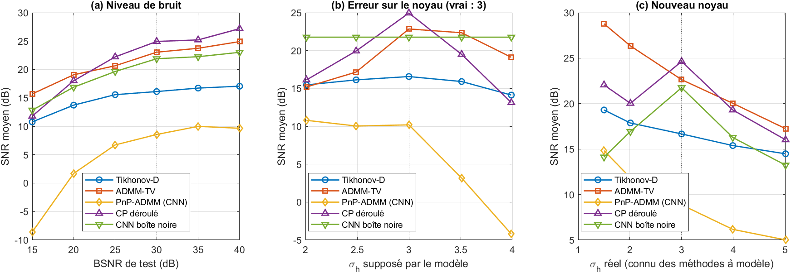

**(a) Niveau de bruit.** À partir de 20 dB, le CP déroulé reste le meilleur. À 15 dB, ADMM-TV le dépasse nettement (15,7 contre 11,8 dB) : les paramètres appris pour 30 dB ne conviennent plus à un bruit beaucoup plus fort. Le CNN boîte noire se dégrade de façon intermédiaire.

**(b) Noyau mal connu** (vrai $\sigma_h = 3$) :

| $\sigma_h$ supposé | 2,0 | 2,5 | 3,0 | 3,5 | 4,0 |
|---|---|---|---|---|---|
| ADMM-TV | 15,2 | 17,2 | 22,8 | 22,4 | 19,1 |
| CP déroulé | 16,1 | 19,9 | 25,0 | 19,5 | 13,1 |
| CNN boîte noire | 21,8 | 21,8 | 21,8 | 21,8 | 21,8 |

Le CNN boîte noire, qui n'utilise pas le modèle, est insensible à cette erreur. Dès que l'erreur sur $\sigma_h$ atteint environ 15 %, il devient meilleur que les méthodes à modèle. Le CP déroulé est le plus sensible : il est très bon avec le bon noyau, mais ses paramètres appris amplifient l'effet d'un modèle faux. Pour ADMM-TV, sous-estimer le flou s'avère ici plus pénalisant que le surestimer.

**(c) Nouveau noyau connu des méthodes à modèle :**

| $\sigma_h$ réel | 1,5 | 2,0 | 3,0 | 4,0 | 5,0 |
|---|---|---|---|---|---|
| ADMM-TV | **28,8** | **26,4** | 22,6 | **20,0** | **17,2** |
| CP déroulé | 22,0 | 20,0 | **24,6** | 19,3 | 16,0 |
| CNN boîte noire | 14,1 | 16,9 | 21,7 | 16,3 | 13,2 |

ADMM-TV s'adapte naturellement et devient la meilleure méthode dès qu'on quitte le noyau d'entraînement. Le CNN boîte noire chute fortement (jusqu'à −8 dB par rapport au nominal). Le CP déroulé, qui reçoit pourtant le bon $H$, perd 3 à 9 dB : ses pas et seuils ont été appris pour un seul noyau. Garder le modèle physique aide, mais ne suffit pas à rendre les paramètres appris transposables.

### 4.7 Déconvolution aveugle (exp. 7)

| Méthode | SNR moyen (dB) | Erreur relative sur le noyau |
|---|---|---|
| Non aveugle (vrai noyau) | 21,22 | — |
| Aveugle, a priori $\ell_0$ | 15,45 | 0,74 |
| Aveugle, a priori TV | 14,78 | 1,12 |
| Noyau faux ($\sigma = 1$) | 14,79 | — |

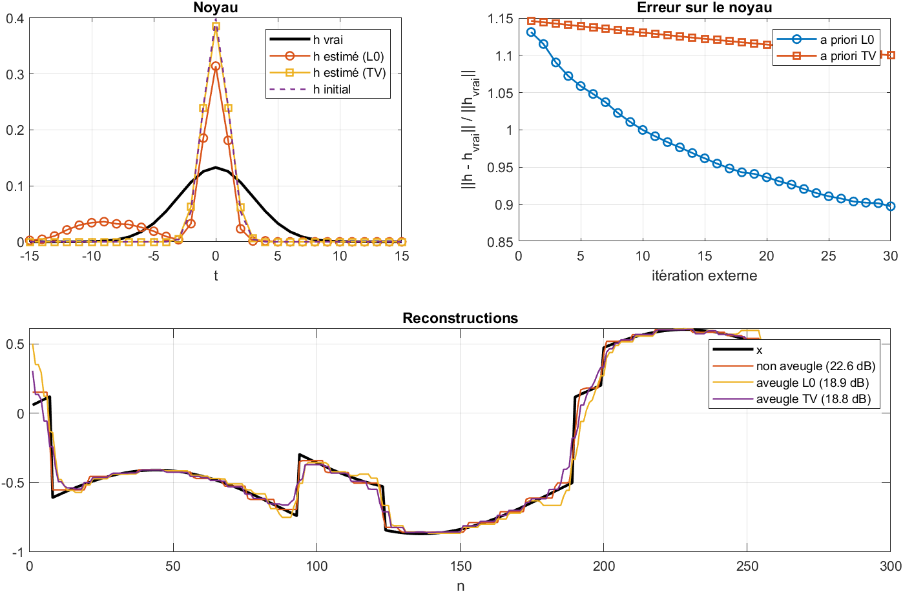

C'est un **succès partiel**. L'a priori $\ell_0$ fait mieux que la TV, dont le noyau reste bloqué près de son initialisation (comportement attendu : la TV ne favorise pas les fronts nets). Mais le gain sur un noyau arbitraire n'est que de 0,7 dB, et le noyau estimé reste trop étroit, avec un lobe parasite. L'erreur sur le noyau diminue encore à la 30ᵉ itération : l'algorithme n'a pas convergé, et le calendrier de continuation est probablement trop court.

## 5. Ce que je retiens

- **La régularisation est indispensable**, et son choix compte plus que l'algorithme : passer de Tikhonov à la TV apporte 4 dB, alors qu'ADMM et Chambolle-Pock donnent le même résultat.
- **Le choix automatique de λ** par GCV ou courbe en L coûte en moyenne moins de 0,2 dB par rapport à l'oracle. Morozov, pourtant mieux informé, fait moins bien.
- **Le dépliage d'algorithme est le meilleur compromis dans les conditions d'entraînement** : meilleure précision, très peu de paramètres, rapide et interprétable.
- **Aucune méthode n'est robuste à tout.** Le CNN boîte noire résiste à une erreur de modèle mais pas à un changement de noyau ; ADMM-TV s'adapte à un nouveau noyau mais souffre d'un modèle faux ; le réseau déroulé combine les faiblesses des deux quand on s'éloigne des conditions d'entraînement.
- **Les a priori spécifiques se transposent mal** à un autre type de signal (audio).
- **Brancher un réseau dans un algorithme itératif n'est pas trivial** : sans précaution, le Plug-and-Play diverge.

## 6. Limites

- **Crime inverse** : les données sont simulées avec le même modèle circulant que celui utilisé pour reconstruire ; les SNR sont optimistes.
- **Signaux de synthèse 1D**, dont la structure favorise naturellement la TV.
- **Morozov** reçoit le vrai σ ; **Wiener oracle** utilise le vrai spectre : ce sont des références, pas des méthodes applicables.
- **PnP-CNN** ne fonctionne pas dans sa version actuelle (section 4.4).
- **Déconvolution aveugle** : le $\lambda$ final est réglé avec le vrai noyau, et l'alternance n'a pas convergé en 30 itérations.
- **Une seule réalisation** de l'entraînement des réseaux : la variabilité due à l'initialisation n'est pas mesurée.
- **Paramètres par défaut** des algorithmes ($\rho = 0{,}1$, $\tau = 5$) choisis à partir de tests préliminaires.

## 7. Pistes d'amélioration

Ce travail laisse plusieurs pistes que nous n’avons pas eu le temps d’explorer, et qu’il serait intéressant d’étudier :

- **Pour la méthode Plug-and-Play**, on pourrait essayer de prolonger le signal de façon périodique avant de l’envoyer au CNN, pour rester cohérent avec le modèle direct utilisé. Il serait aussi intéressant de tester un débruiteur qui prend en entrée le niveau de bruit (dans l’esprit de FFDNet), de faire augmenter progressivement $\rho$ au fil des itérations, et d’arrêter l’algorithme plus tôt pour éviter qu’il ne se dégrade.
-**Pour le réseau déroulé**, l’entraîner sur plusieurs noyaux et plusieurs niveaux de bruit pourrait le rendre plus robuste. Une autre idée serait d’imposer des contraintes sur les pas appris, afin de garder les garanties de convergence de l’algorithme d’origine.
Pour la déconvolution aveugle, nos résultats suggèrent qu’une phase de continuation plus longue et un critère d’arrêt adaptatif pourraient améliorer l’estimation. Le choix de $\lambda$ sans connaître le noyau reste une question que nous n’avons pas réussi à traiter de façon satisfaisante.
-**Concernant les bords**, nous avons utilisé des conditions périodiques, ce qui simplifie les calculs mais rend nos résultats probablement un peu optimistes (crime inverse). Il faudrait vérifier ce qui se passe avec des conditions réfléchies (diagonalisées par la DCT), ou en simulant les données par une convolution linéaire.
À plus long terme, il serait naturel d’étendre ce travail aux images 2D, de considérer un bruit de Poisson (plus réaliste pour certaines applications), ou encore d’adopter une approche bayésienne, qui permettrait d’estimer l’incertitude sur la reconstruction.

## 8. Utilisation

**Prérequis** : MATLAB R2021a ou plus récent. Les expériences 1, 2, 3 et 7 ne demandent aucune toolbox ; les expériences 4, 5 et 6 demandent la Deep Learning Toolbox.

```matlab
startup_project          % ajoute les chemins, crée results/ et models/
run_tests                % tests unitaires
main                     % toutes les expériences
```

Chaque expérience peut être lancée seule, avec une configuration modifiée :

```matlab
cfg = default_config();
cfg.kernel_param = 4;    % flou plus fort
cfg.bsnr = 25;           % plus de bruit
exp03_tv_methods(cfg);
```

Au premier lancement des expériences 4 à 6, les réseaux sont entraînés puis mis en cache dans `models/trained_models.mat`. Ils sont ré-entraînés si la configuration change, ou si `cfg.retrain = true`.

```
.
├── main.m, startup_project.m
├── src/
│   ├── operators/    # noyaux, H et D par FFT, matrices circulantes
│   ├── methods/      # méthodes classiques, variationnelles, aveugle
│   ├── learning/     # réseau déroulé, CNN, entraînement
│   └── utils/        # configuration, données, métriques
├── experiments/      # exp01 à exp07
├── tests/            # tests unitaires
├── results/          # figures et tableaux générés
└── models/           # modèles entraînés (non versionnés)
```

## 9. Références

- P. C. Hansen, *Discrete Inverse Problems: Insight and Algorithms*, SIAM, 2010.
- J. Idier (dir.), *Approche bayésienne pour les problèmes inverses*, Hermès, 2001.
- L. Rudin, S. Osher, E. Fatemi, « Nonlinear total variation based noise removal algorithms », *Physica D*, 1992.
- A. Chambolle, « An algorithm for total variation minimization and applications », *JMIV*, 2004.
- A. Beck, M. Teboulle, « A fast iterative shrinkage-thresholding algorithm for linear inverse problems », *SIAM J. Imaging Sci.*, 2009.
- S. Boyd et al., « Distributed optimization and statistical learning via the alternating direction method of multipliers », *Found. Trends Mach. Learn.*, 2011.
- A. Chambolle, T. Pock, « A first-order primal-dual algorithm for convex problems with applications to imaging », *JMIV*, 2011.
- S. Venkatakrishnan, C. Bouman, B. Wohlberg, « Plug-and-Play priors for model based reconstruction », *GlobalSIP*, 2013.
- K. Gregor, Y. LeCun, « Learning fast approximations of sparse coding », *ICML*, 2010.
- K. Zhang et al., « Beyond a Gaussian denoiser: residual learning of deep CNN for image denoising », *IEEE TIP*, 2017.
- L. Xu, S. Zheng, J. Jia, « Unnatural L0 sparse representation for natural image deblurring », *CVPR*, 2013.
- D. Perrone, P. Favaro, « Total variation blind deconvolution: the devil is in the details », *CVPR*, 2014.
- V. Monga, Y. Li, Y. Eldar, « Algorithm unrolling: interpretable, efficient deep learning for signal and image processing », *IEEE Signal Process. Mag.*, 2021.
- J. Duchi et al., « Efficient projections onto the l1-ball for learning in high dimensions », *ICML*, 2008.


